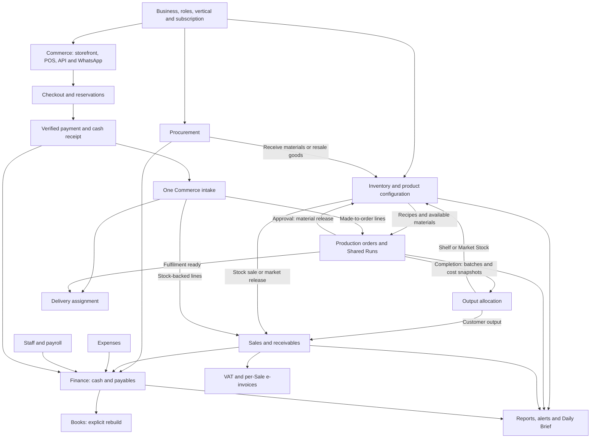

# System interconnection review

> Implementation follow-up (29 October 2026): the findings below describe the
> original audit. Corrections, the procurement approval workflow and deployment
> notes are documented in [System integrity fixes](SYSTEM_INTEGRITY_FIXES.md).
> See [test results](SYSTEM_REVIEW_TEST_FAILURES.md) for the subsequent validation.

Reviewed: 29 October 2026. This describes the current working tree, including its uncommitted additions; it is not a certification of the deployed site.

## Assessment

The main operational modules are connected. Procurement, inventory, production, sales, commerce payments, delivery and finance share records and explicit transaction services. However, several reproducible integrity gaps prevent an “everything is working well” conclusion. The most urgent work is around expense settlement, posted-record deletion and concurrent stock updates.

This was an audit. No business database was changed, no external payment/message was sent, and no operational code was repaired.

## Findings requiring attention

### 1. High: paid expense edits do not update their cash effects

The existing-expense branch of [expense_form](../apps/expenses/views.py) saves amount, account, date and payment status without reconciling the previously posted cash movement. The new-expense branch does post cash, so the two paths behave differently.

Reproduced in an isolated database: an expense and outflow initially equal to 100; edit the paid expense to 200; the expense becomes 200 while its outflow remains 100. The form also permits changing an unpaid expense to paid without this branch creating a payment.

**Needed:** a defined correction/reversal workflow for posted expenses, atomic source and cash updates, and restrictions on direct settlement-state edits.

### 2. High: partial expense payments can overpay, and payables remain overstated

[ExpensePaymentForm.clean_amount](../apps/expenses/forms.py) compares the new payment with the original expense amount, without subtracting earlier payments. The payment view adds previous payments to decide whether the expense is paid, but does not reject an aggregate overpayment. [Finance open items](../apps/core/finance_views.py) reports the full amount of an expense while its status remains unpaid.

Reproduced: a 100 expense with a previous payment of 60 accepts a second payment of 60. After the first payment, Finance still reports a payable of 100 rather than 40. This also affects consumers of the open-items helper, including the brief and Books tie-out.

**Needed:** one outstanding-balance calculation shared by validation, Finance, reports and briefs; lock the expense during settlement and validate the remaining amount inside the transaction.

### 3. High: posted sales, received purchases and paid expenses can be deleted without reversal

The delete views in [Sales](../apps/sales/views.py), [Procurement](../apps/procurement/views.py) and [Expenses](../apps/expenses/views.py) allow ordinary records to be deleted without compensating their posted effects. Sales blocks Market Stock releases and sales with distribution returns, but ordinary direct sales remain deletable. Some related records protect deletion through foreign keys; that does not protect the ordinary cases below.

Reproduced through the authenticated view functions in an isolated database:

- A direct sale is deleted while reduced finished-goods stock, its stock movement and its income transaction remain.
- A received purchase order is deleted while its received raw-material stock and movement remain.
- A paid expense is deleted while its cash outflow remains.

The core save/delete signals invalidate caches; they do not implement compensating reversal. Rebuilding Books after source deletion can therefore leave cash settlement without the original accrual record.

**Needed:** restrict deletion to drafts/unposted records; use audited cancellation or reversal for posted records and check downstream dependencies.

### 4. High: raw-material updates can lose another stock change

[record_raw_material_movement](../apps/inventory/services.py) calculates the new balance from the supplied model instance and saves it without first locking/reloading that material. Production approval locks the order/run, and procurement receipt locks the purchase order; those locks do not serialize different documents touching the same material.

Reproduced with two stale instances: start at 10, deduct 3 through one instance and 4 through the other. The stored balance ends at 6 while the two movement records imply 3. This demonstrates the helper's lost-update behavior; it is not a PostgreSQL concurrency stress test.

Related code-review risks requiring a concurrent PostgreSQL test:

- Direct-sales availability is checked before the stock mutation transaction. The finished-goods movement helper locks the product but does not recheck availability or reservations before deduction.
- Production completion checks order status before its atomic block without locking and rechecking the order at the completion boundary. Simultaneous submissions need an idempotency check.

**Needed:** stable lock ordering, fresh balances and availability checks under the locks, and idempotent approval/completion boundaries.

### 5. High: tenant JSON backup is an operational subset

[tenant_backup_querysets](../apps/core/services.py) explicitly includes stock, purchasing, production, sales, expenses, cash and audit records. It omits newer groups such as Commerce checkout/payment/delivery, payroll, manual journals and chart of accounts, tax/input VAT/e-invoices, and ledger cut-over/opening positions.

The omission was verified from the returned model list. No complete restore of these newer groups was demonstrated. The existing operational export should not be relied on as a complete tenant recovery mechanism.

**Needed:** a versioned backup/restore schema, explicit coverage of tenant-owned models and child tables, a policy for encrypted credentials, and an isolated round-trip recovery check.

### 6. High: changing batch yield can rewrite historical sale totals

[SaleItem.total_units and line_total](../apps/sales/models.py) derive batch quantities using the product's current `units_per_batch`. The shared [reporting expressions](../apps/core/accounting.py) do the same. Price and unit cost snapshots do not freeze the batch-to-piece conversion. Commerce lines with explicit commercial quantity/price have a separate total calculation, so this finding specifically concerns ordinary batch-based lines.

An isolated diagnostic creates one batch at 100 pieces and price 2, then changes the product yield to 120. The unchanged Sale recalculates from 200 to 240. Customer balances, reporting, regenerated Books and VAT can therefore change when the catalogue is edited.

**Needed:** snapshot sold physical units/conversion on the transaction line and have invoices, balances and reporting consume that snapshot. Historical backfill needs an explicit policy; the present product yield cannot reliably reconstruct the original value.

### 7. Medium: Books inventory tie-out silently limits finished goods

[books.tie_out](../apps/core/books.py) values only the first 1,000 positive-stock finished goods and silently skips valuation exceptions. Larger catalogues can therefore receive an incomplete operational inventory total. This is a source-code finding; a 1,001-product valuation scenario was not executed.

**Needed:** value the complete tenant catalogue efficiently; surface valuation errors and any deliberate limits.

### 8. Medium: automated regression coverage needs reconciliation

The existing suite contains mismatches with current behavior, including external storefront channel restrictions, required Distribution pricing, stock-only intakes now reaching `fulfilled`, changed socket-access return values, UI markup and copy. These failures must be reviewed individually; a failing test is not automatically proof the workflow is broken, and changing expectations without checking the intended contract would hide regressions.

No dedicated Django test module was found under `apps/whatsapp_storefront`. That integration needs direct tests for signed webhooks, deduplication, queue retries, chat-window restrictions, tenant isolation and checkout handoff.

## Module map

Tenant scoping and ledger period rules apply across this map. Arrows show implemented handoffs; they do not imply every action is automatic or every exception path is correct.

## How each flow works

| Module | Inputs and handoff | Important distinction |
| --- | --- | --- |
| Business, users and plans | A Business selects its vertical; active memberships, roles and subscription entitlements determine available workspaces and actions. Middleware resolves the request business and clears context afterward. | A disabled workspace must not stop required cross-module record creation. Scoped managers depend on request context; background tasks must explicitly scope the business. |
| Product and inventory setup | Products define made-in-house versus purchased-for-resale sourcing, units, recipes, production inputs, channel prices, portions/packs and stock behavior. | Wholesale/retail can follow purchase → stock → sale without manufacturing. Product stock and movement history must agree. |
| Procurement | Supplier directory → purchase order and lines → receipt → raw-material or resale-product movement. Receipts capture unit costs; raw materials also receive dated cost snapshots. Payments post cash and settle supplier balances. | Ordering, receiving and paying are separate events. Receiving a PO is not the same as paying it. Receipt retries are guarded by a locked PO and received status. |
| Production entry | Staff enter demand/output plans and flexible input information. Pending/unassigned work must have its destination resolved before approval. Kitchen access is purpose-specific. | Saving an entry/report does not itself release materials. Demand, planned output and actual output remain separate. |
| Order approval | Recipe requirements are proportional to planned output against registered batch yield. Approval records `OrderMaterialUsage` and raw-material release. | README passages describing whole-batch material consumption are stale; current code uses proportional requirements. |
| Shared Production Runs | Multiple pending orders retain separate customer/channel identities. One run aggregates their requirements and releases materials once. Individual approval is blocked while an order belongs to a draft run. | A Shared Run coordinates production; it does not turn several customers into one commercial order. Members complete through their own output records. |
| Completion and QC | Actual produced/wasted quantities, batch/expiry, quality checks, shortages and output destinations are recorded. Dated input costs build production cost snapshots. Output becomes shelf stock, Market Stock, customer delivery/sale, allocated planned offcut or separately classified excess. | Completing a customer order creates its commercial sale; it should not also inflate shelf stock for the same committed units. Labour/overhead manufacturing capitalization is not a complete MRP/WIP implementation. |
| Recipe variance | Planned versus actual released inputs come from `OrderMaterialUsage`; batches supply planned/actual/waste output, and stock adjustments contribute shrinkage. | Ingredient “actual” means recorded release, not independently measured consumption. Value impact uses current material cost. The review threshold is 5%. |
| Market Stock and returns | Production can create Market Stock lots; releases allocate available lots and create Distribution sales. Transfers move Market Stock to the physical channel; returns distinguish redistributable goods from damage. | Distribution requires its own channel/customer price. Stock return, damage and expiry have different movement histories and commercial effects. |
| Direct sales | Stock availability and checkout reservations are checked; a Sale stores line prices/costs, inventory is deducted and paid sales record income. | Unpaid walk-in product issues are treated differently from Distribution/Online customer receivables. Do not assume every unpaid issue appears in customer debt. |
| Commerce checkout | Hosted storefront, staff POS, API and WhatsApp use the shared checkout/payment services. Server-side prices, options, fulfilment sources and stock reservations determine the payable order. | External storefronts/integrations use the Online channel. Physical/Distribution selection belongs to the in-premise POS. An unpaid checkout is not yet an operational intake. |
| Verified payment | A manual claim or provider verification becomes a receipt and one actual cash transaction. Idempotency and external-reference checks protect retries. Full payment materializes one intake. | Browser redirects and uploaded claims alone are not payment confirmation. Late payment or failed fulfilment can remain paid but require review; the confirmed money must not disappear. |
| Commerce fulfilment | Stock-backed intake lines create stock sales; made-to-order lines create pending production orders. Mixed intakes can create both. Existing receipts are allocated to downstream Sales using CustomerPayment records. | Allocating receipts does not post a second cash receipt. Production completion synchronizes the commerce payment and originating intake. |
| Delivery | A quote can be frozen into checkout, then become an assignment. Stock-only fulfilment or completed production makes the intake ready. Driver/batch assignment, pickup, delivery status, proof and issue records follow. | Pickup/ready transitions require full fulfilment; quoted delivery fees and product totals are separate. External courier calls still depend on configured providers. |
| Customer/supplier settlement | Payments link to the relevant Sale/PO, update settlement state and record cash. Commerce payment allocations reuse already-posted cash. | A commercial sale, a receivable and an actual cash receipt are different records. Partial expense handling currently violates this separation; see finding 2. |
| Payroll | Staff profiles, recurring adjustments and calculation rules produce payslips and payroll runs. Finance-posted runs create cash outflows by funding account; issued-payslip corrections can post an auditable delta. | Operational profit uses employer cost from issued payslips; Books classifies payroll cash movements. These figures can differ by timing and unpaid obligations. Payroll addon subscription billing is separate from employee pay. |
| Finance and reconciliation | Cash accounts aggregate actual money movements; open-item calculations derive receivables/payables. Bank-statement reconciliation matches statement entries to existing transactions. | Cash balance is not profit. A matched bank statement does not prove that all stock, source documents or journals are correct. |
| Operational reports and financial packs | Paid sales and their line costs, incurred expenses, issued payroll, operational supplies and write-offs feed operational profitability. Packs collect financial/stock summaries and can be shared using expiring/revocable tokens. | Operational P&L recognizes only fully paid sales; Books recognizes recorded sales on an accrual basis. Daily Brief sales and VAT read Sales without that paid-only filter. These figures can differ even when the records are internally consistent. Reports also inherit source-record inaccuracies. |
| Double-entry Books | Explicit rebuild derives balanced journals from sales, received purchases, expenses, adjustments, cash, input VAT and openings. Trial balance, registers and statements use those journals. Manual journals survive rebuild and have a reversal path. | Books is not continuously posted. Rebuild after source changes. Unclassified cash goes to Suspense. Opening stock and production conversion treatment need accountant review; a balanced trial balance alone does not prove correctness. |
| Tax and VAT | Business registration/date/rate and product treatment determine VAT-inclusive extraction from Sales. Claimable/nonclaimable input VAT is separately entered. | This is a configured VAT register/report, not automatic filing or a full tax engine. Current product/settings changes can affect regenerated historical reports; tax treatment is not frozen on every Sale line. |
| E-invoicing | Prepare an invoice from an existing Sale, then submit to a configured provider or record external clearance identifiers. | It applies to storefront-generated Sales too, once they exist. A checkout/preorder has no Sale invoice yet. Local preparation is not authority clearance; provider mapping and live acceptance need independent verification. |
| Ledger cut-over | A business records a live start and opening positions, enters earlier activity as Backlog, checks integrity, then locks/merges or archives under admin control. Backlog movements do not mutate live stock counters. | This separates operational periods; it is not the double-entry Books module. Books and tax intentionally read both periods with explicit tenant scoping. |
| Daily Brief | `/brief/` summarizes yesterday's sales/expenses plus current cash, debt, stock warnings, pending orders and recipe attention. Members can read/copy/share, enable email and configure WhatsApp delivery. | Sidebar access follows Dashboard permission. Scheduled sends run after 07:00 local time and require the scheduled job runner. The brief inherits Finance open-item errors. |
| WhatsApp | Manual `wa.me` sharing opens prefilled raw text without a Meta template. The automated storefront assistant handles incoming chat, catalogue/basket, checkout and payment links through Commerce. Queue workers send outbound messages. | Automated daily brief uses a configured approved template and consent; without a template it reports `no_template` and can fall back to email. Raw-text sharing is manual. Automated chat text has separate connection/chat-window requirements. |
| Proposed staff assistant | [The tenant assistant document](TENANT_ASSISTANT_PROPOSAL.md) describes a future authenticated, permission-aware assistant using existing read services and source links. | This remains a proposal. The existing customer-facing WhatsApp assistant is not a general staff assistant across Finance, stock and production. Correct the underlying balance/reporting gaps before exposing those figures through another interface. |
| Background jobs and notifications | The scheduled registry runs subscription sync, platform email, WhatsApp queue and daily briefs. A database lease prevents overlapping registry runs. Commerce also queues notifications and publishes checkout changes. | Code registration does not prove production cron, worker processes, cache, ASGI/WebSocket or push delivery are deployed correctly. |

## Validation and limits

The audit traced application routes, middleware, models, forms, transaction helpers, reports and tests. Isolated tests use SQLite and local email/cache settings; no production database or external provider was used.

- Django system check: no issues reported.
- Migration model-state check: `makemigrations --check --dry-run` reported **No changes detected**.
- Full existing app suite with real repository migrations: **729 tests; 684 passed, 36 failed, 9 errored**. The [failure inventory](SYSTEM_REVIEW_TEST_FAILURES.md) records each failing test and its short error. A second run using synchronized model tables gave the same totals with local-memory cache. The initial UI settings run used DummyCache and produced different totals, so it is not the reported baseline.
- Focused regression suite for Books, tax, ledger/cut-over registry, daily briefs, bank reconciliation, operational accounting, financial packs, workspace navigation and recipe variance: **166 tests passed**. This used synchronized model tables and local-memory cache; it is a subset rerun, not 166 additional independent scenarios beyond the full suite.
- **Eight temporary diagnostic scenarios reproduced the findings**, including the backup model-list omission, stale-instance stock update and changed historical batch-sale total. Their passing assertions confirm the defects/omission; they are not successful business workflows. These called view functions with authenticated requests and explicit business context, not browser end-to-end requests.
- The full-suite run created its isolated database through the actual migration chain and completed. A separate migration diagnostic instrumented with Python's repeating traceback timer crashed with exit 139 during migration setup; no targeted test executed in that diagnostic. That crash was not reproduced in the completed uninstrumented full-suite run.
- Playwright: **15 browser tests passed**, covering the four marketing scenarios and eleven workspace scenarios: form save/validation, discard confirmation and focus, searchable selectors/formsets, dialogs, cancelled actions, button styling, theme-aware logos, feature matrices, read-only authorization, text contrast/mobile layout and appearance controls. The first attempts were blocked by localhost restrictions, missing Chromium and missing shared libraries. A temporary Chromium download and unpacked runtime libraries under `/tmp` enabled the completed run; no host packages were installed. These are fixture-based UI checks, not end-to-end tests of every financial or stock workflow.
- Dedicated tests under `tests/ui` are separate from the Django app suite. No expense-app test module was found among the discovered modules; the temporary diagnostics specifically filled part of that gap.
- PostgreSQL race behavior, real tenant balances, deployed migration status, payment providers, Meta approval/delivery, mail delivery, courier acceptance and the production scheduler remain unverified.

## Recommended order of work

1. Fix expense settlement and correction behavior; protect posted-record deletion.
2. Freeze transaction quantities/conversions, and make stock mutation and production completion safe under concurrent requests.
3. Expand and round-trip-test tenant backup/restore for all newer modules.
4. Reconcile failing regression tests with intended workflow contracts; add direct expense and WhatsApp coverage.
5. Correct the Books valuation limit and document accounting/reporting differences and historical tax-setting behavior.
6. Run PostgreSQL concurrency tests and provider sandbox checks, then verify the actual deployment's migrations, workers and scheduler.
